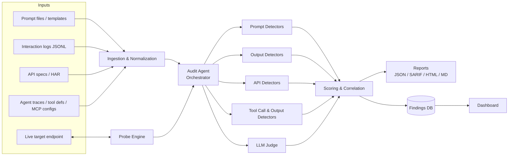

# LLM Security Auditor: Project Plan

An agent that automatically audits **prompts**, **model outputs**, **tool calls and tool outputs**, and **API interactions** of LLM-powered applications for security vulnerabilities, and produces actionable, prioritized reports.

---

## 1. Problem Statement

Organizations are shipping LLM features (chatbots, RAG assistants, AI agents with tools) faster than they can secure them. Security reviews today are mostly manual, inconsistent, and happen once, if at all. Common failures go unnoticed:

- System prompts containing secrets or relying on "please don't reveal this" for access control
- User input concatenated straight into prompts, which enables prompt injection
- Model outputs rendered as HTML, executed as code, or passed to SQL/shell without validation
- Agents given tools with far more permission than they need
- Tool results (web pages, emails, files, API responses) fed back into the model unchecked, letting attackers hijack agents indirectly
- API keys in client code, no rate limits, unbounded token usage, PII written to logs

**Goal:** Give teams an automated, repeatable security assessment for LLM systems, the way SAST/DAST tools work for traditional software.

---

## 2. Objectives and Success Criteria

| # | Objective | Measurable success criterion |
|---|-----------|------------------------------|
| 1 | Detect prompt-level vulnerabilities | ≥ 90% recall on a labeled prompt-injection test set, ≤ 5% false-positive rate on benign prompts |
| 2 | Detect unsafe/leaky outputs | Catches planted PII, secrets, system-prompt leaks, and XSS/SQL payloads in a test corpus |
| 3 | Audit API interactions, tool calls, and tool outputs | Flags all planted misconfigurations and tool-level flaws in a deliberately vulnerable demo app |
| 4 | Actively probe a live target (red-teaming) | Runs a configurable attack suite against an endpoint and confirms exploitable issues |
| 5 | Report clearly | Every finding has severity, evidence, OWASP mapping, and a concrete fix |
| 6 | Fit into workflows | Usable as a CLI, in CI (SARIF output), and as a REST API |

---

## 3. Scope

### 3.1 What the agent audits

| Surface | Input formats | Examples of what it looks for |
|---------|---------------|-------------------------------|
| **Prompts** | System prompts, prompt templates (`.txt`, `.md`, `.jinja`, code strings), user prompts from logs | Injection/jailbreak patterns, embedded secrets/PII, unsafe template interpolation, weak instruction hierarchy, obfuscated payloads |
| **Outputs** | Model responses from logs or live probes | PII/secret leakage, system prompt leakage, XSS/SQL/shell payloads, insecure generated code, hallucinated packages/URLs, harmful content |
| **API interactions** | Request/response logs (JSONL), HAR files, OpenAPI specs, app config | Missing auth, exposed keys, no rate/token limits, verbose errors, PII in logs |
| **Tool calls & tool outputs** | Agent traces (tool-use messages, LangChain/LangSmith exports, OpenTelemetry GenAI spans), tool/function definitions, MCP server configs | Over-privileged tools, dangerous arguments, injection hidden in tool results, sensitive data in tool results, hijacked or chained calls that exfiltrate data, poisoned tool descriptions |

### 3.2 Operating modes

1. **Static audit**: analyze files (prompts, logs, specs, configs) offline. *No live traffic needed.*
2. **Active probing (red-team)**: send crafted attack prompts to a target endpoint and judge the responses.
3. **Runtime monitoring (stretch goal)**: run as a proxy between an app and its LLM provider, scanning traffic in real time.

### 3.3 Out of scope for v1

- Model training-data poisoning detection (needs access to training pipelines)
- Model weight / adversarial-ML attacks (evasion on embeddings, gradient attacks)
- Automatic patching of the target application

---

## 4. Threat Framework

All findings map to the **OWASP Top 10 for LLM Applications (2025)** so reports speak a language security teams already know. MITRE ATLAS technique IDs are added where relevant.

| OWASP ID | Risk | Covered by |
|----------|------|-----------|
| LLM01 | Prompt Injection | Prompt detectors, tool-output scanning, injection probes |
| LLM02 | Sensitive Information Disclosure | PII/secret detectors on prompts and outputs |
| LLM03 | Supply Chain | Model/package pinning, tool/MCP definition pinning, hallucinated-package detection |
| LLM04 | Data and Model Poisoning | Out of scope v1 (partial: RAG document scanning) |
| LLM05 | Improper Output Handling | Output sink detectors (XSS, SQL, shell, markdown exfiltration) |
| LLM06 | Excessive Agency | Tool permission, tool-call sequence, and MCP checks |
| LLM07 | System Prompt Leakage | Secrets-in-system-prompt check, canary-based extraction probes |
| LLM08 | Vector and Embedding Weaknesses | RAG document injection scan, vector store access checks |
| LLM09 | Misinformation | Hallucinated package/URL detection, LLM judge |
| LLM10 | Unbounded Consumption | Rate limit / `max_tokens` / cost-control checks |

---

## 5. System Architecture



### 5.1 Components

| Component | Responsibility |
|-----------|----------------|
| **Ingestion & Normalization** | Loads every input type and converts it into one common `Interaction` record (see §7) so detectors don't care where data came from. Redacts secrets before storage. |
| **Detectors** | Small, independent, testable checks. Each takes normalized input and returns zero or more `Finding`s. Four families: prompt, output, API, tool. |
| **Probe Engine** | Library of attack payloads + mutators (encoding, translation, role-play wrappers, payload splitting). Sends probes to a target, collects responses, hands them to detectors and the judge. |
| **LLM Judge** | Uses an LLM with strict rubrics for cases rules can't decide (e.g., "did the model comply with the jailbreak?", "is this system prompt's instruction hierarchy weak?"). Returns structured verdicts with confidence. |
| **Audit Agent (Orchestrator)** | The "agent" part. Plans which checks to run for a given scope, runs them via tools, verifies uncertain findings, chains related findings, and writes remediation guidance. |
| **Scoring & Correlation** | Assigns severity, de-duplicates, and escalates attack chains (e.g., *secret in system prompt* + *system prompt extractable* = **Critical**). |
| **Reporting** | JSON (machine), SARIF (GitHub code scanning / CI), HTML and Markdown (humans). |
| **Findings DB + Dashboard** | Stores audit runs over time, shows trends and regressions. |

### 5.2 Design principles

1. **Deterministic first, LLM second.** Regex, parsers, and classifiers run first: fast, cheap, reproducible. The LLM judge is only called for ambiguous cases. This keeps cost low and results explainable.
2. **Audited content is untrusted.** The prompts and outputs we audit may contain injection attacks *aimed at the auditor's own judge*. The judge must receive content as clearly delimited data, return structured output only, and never have tools that act on that content.
3. **Every finding has evidence.** No finding without the exact snippet, location, and reason. Raw secrets are redacted in evidence (`sk-****abcd`).
4. **Pluggable everything.** Detectors, probes, LLM providers, and report formats are plugins, so new attack techniques can be added without touching the core.
5. **Safe by default.** Active probing requires an explicit target allow-list, is rate-limited, and ships no destructive payloads.

---

## 6. The Agent Design

The orchestrator follows a **Plan → Execute → Verify → Report** loop.

```
┌─────────┐    ┌──────────┐    ┌──────────┐    ┌──────────┐
│  PLAN   │ →  │ EXECUTE  │ →  │  VERIFY  │ →  │  REPORT  │
└─────────┘    └──────────┘    └──────────┘    └──────────┘
 Read scope     Call detector   Re-probe or     Score, chain,
 & inputs,      / probe tools,  ask judge to    write fixes,
 pick checks    collect raw     confirm low-    emit reports
                findings        confidence hits
```

### 6.1 Agent tools

| Tool | Purpose |
|------|---------|
| `scan_prompts(paths)` | Run all prompt detectors on files/templates |
| `scan_outputs(log_path)` | Run output detectors over logged responses |
| `inspect_api(spec_or_har)` | Run API/config detectors |
| `inspect_tools(tool_defs_or_mcp_config)` | Analyze tool/MCP definitions for excessive agency, poisoning, drift, shadowing |
| `scan_agent_traces(trace_path)` | Check tool calls and tool results in agent traces |
| `run_probe_suite(target, suite)` | Execute a red-team probe suite against an allowed target |
| `judge(content, rubric)` | Ask the LLM judge for a structured verdict |
| `verify_finding(finding_id)` | Re-test a finding (e.g., repeat a probe 3×) to confirm it |
| `write_report(format)` | Produce final report |

### 6.2 What the agent adds over a plain scanner

- **Adaptive probing:** if a basic injection is blocked, it escalates to encoded, multi-turn, or role-play variants.
- **False-positive reduction:** low-confidence hits get verified before they reach the report.
- **Attack-chain reasoning:** links separate low/medium findings into realistic high-impact scenarios.
- **Context-aware remediation:** fixes tailored to the actual code/prompt, not generic advice.

### 6.3 LLM provider

Use a provider-agnostic interface (`LLMClient`) so the judge and agent can run on any model. Suggested defaults:

- **Orchestrator / judge:** a strong reasoning model (e.g., `claude-opus-5-5` or `claude-sonnet-5-5`)
- **High-volume classification:** a fast, cheap model (e.g., `claude-haiku-5-5`)
- **Offline / private mode:** a local model via Ollama for organizations that can't send data out

---

## 7. Core Data Models

### 7.1 Normalized interaction

Every input (log line, HAR entry, probe result) becomes one of these:

```json
{
  "id": "int_0001",
  "source": "logs/chat_2026-10-01.jsonl:42",
  "timestamp": "2026-10-01T10:15:00Z",
  "model": "gpt-x / claude-x / local",
  "system_prompt": "You are a support bot...",
  "messages": [{"role": "user", "content": "..."}],
  "tool_definitions": [
    {"name": "fetch_url", "description": "...", "parameters": {}, "source": "mcp://browser-server"}
  ],
  "tool_calls": [
    {"id": "call_1", "name": "fetch_url", "arguments": {"url": "https://example.com/doc"}}
  ],
  "tool_results": [
    {"call_id": "call_1", "content": "...page text returned to the model...", "is_error": false}
  ],
  "response": "...",
  "request_meta": {
    "endpoint": "https://api.example.com/chat",
    "method": "POST",
    "headers_redacted": {"Authorization": "Bearer ****"},
    "params": {"max_tokens": null, "temperature": 0.7}
  }
}
```

For multi-step agent runs, `messages` keeps the full ordered sequence (user turn → tool call → tool result → …), so sequence checks like T-06 and T-07 can see what happened in which order.

### 7.2 Finding

```json
{
  "id": "F-2026-0007",
  "check_id": "P-01",
  "title": "Hard-coded API key in system prompt",
  "severity": "high",
  "confidence": 0.98,
  "owasp": ["LLM02", "LLM07"],
  "surface": "prompt",
  "location": {"file": "prompts/support.txt", "line": 12},
  "evidence": "...use key sk-****9f2a to call the billing API...",
  "description": "A live credential is embedded in the system prompt. System prompts can be extracted by users.",
  "remediation": "Remove the key from the prompt. Have the backend call the billing API with credentials stored in a secrets manager.",
  "verified": true,
  "detected_by": "regex:secrets"
}
```

### 7.3 Severity model

`severity = f(impact, exploitability) × confidence`, bucketed into **Critical / High / Medium / Low / Info**. Correlation rules can escalate severity when findings combine into a chain.

---

## 8. Detection Catalog (v1)

### 8.1 Prompt checks

| ID | Check | OWASP | Method |
|----|-------|-------|--------|
| P-01 | Secrets/credentials embedded in prompts | LLM02, LLM07 | Regex + entropy (detect-secrets style) |
| P-02 | PII embedded in prompts | LLM02 | Presidio / NER |
| P-03 | Unsafe template interpolation (raw `{user_input}` with no delimiters) | LLM01 | Template parser |
| P-04 | Weak/missing instruction hierarchy | LLM01 | LLM judge with rubric |
| P-05 | Over-privileged instructions ("you may run any command") | LLM06 | Rules + LLM judge |
| P-06 | Security controls enforced only by the prompt ("never reveal X") | LLM07 | Rules + LLM judge |
| P-07 | Direct injection / jailbreak patterns in user prompts | LLM01 | Classifier + signature rules |
| P-08 | Indirect injection in RAG documents / retrieved content | LLM01, LLM08 | Classifier on documents |
| P-09 | Obfuscated payloads (base64, invisible Unicode tags, homoglyphs, zero-width chars) | LLM01 | Decoders + Unicode analysis |

### 8.2 Output checks

| ID | Check | OWASP | Method |
|----|-------|-------|--------|
| O-01 | PII leakage | LLM02 | Presidio / NER |
| O-02 | Secret/credential leakage | LLM02 | Regex + entropy |
| O-03 | System prompt leakage | LLM07 | Canary tokens + similarity to known system prompt |
| O-04 | Dangerous content for downstream sinks (HTML/JS, SQL, shell) | LLM05 | Parsers + signatures |
| O-05 | Markdown/image-link data exfiltration (``) | LLM05 | URL + query-param analysis |
| O-06 | Insecure generated code | LLM05 | Bandit / Semgrep on code blocks |
| O-07 | Hallucinated packages / URLs | LLM09, LLM03 | Registry lookups (PyPI/npm) |
| O-08 | Jailbreak success (model complied with disallowed request) | LLM01 | LLM judge |
| O-09 | Harmful / policy-violating content | n/a | Moderation classifier |

### 8.3 API and configuration checks

| ID | Check | OWASP | Method |
|----|-------|-------|--------|
| A-01 | API keys exposed in client code, URLs, or logs | LLM02 | Regex over HAR/logs/source |
| A-02 | LLM endpoints with no authentication | n/a | OpenAPI security schema + HAR |
| A-03 | No rate limiting / unbounded `max_tokens` / no cost caps | LLM10 | Config + header analysis |
| A-04 | Plain HTTP / weak TLS to LLM provider | n/a | URL + TLS check |
| A-05 | Verbose errors leaking stack traces, provider, or model details | LLM02 | Response analysis |
| A-06 | Raw prompts/PII logged without redaction | LLM02 | Log content scan |
| A-07 | Unpinned model versions / untrusted model sources | LLM03 | Config analysis |
| A-08 | RAG/vector store without per-tenant access control | LLM08 | Config + probe |

### 8.4 Tool call and tool output checks

Agents don't only take prompts and return outputs. They call tools and read the tool results back into their context. Tool results (web pages, emails, files, API responses) are the main path for indirect prompt injection, so **every tool result is treated as untrusted input**, exactly like a user prompt.

```
User prompt ─► Model ─► Tool call ─► Tool ─► Tool result ─► Model ─► Output
 P-checks               T-01, T-02           T-03 – T-05             O-checks

Across the whole run:     T-06 hijacked calls, T-07 exfiltration chains, T-08 runaway loops
Tool definitions / MCP:   T-09 – T-13 (checked before the agent ever runs)
```

| ID | Check | OWASP | Method |
|----|-------|-------|--------|
| T-01 | Destructive tool calls (delete, pay, send, deploy) without human approval | LLM06 | Tool config + call logs |
| T-02 | Dangerous tool-call arguments: shell metacharacters, path traversal, internal IPs (SSRF), SQL | LLM05, LLM06 | Argument pattern checks against the tool schema |
| T-03 | Prompt injection hidden in tool results (web pages, emails, files, API responses) | LLM01 | Injection classifier + obfuscation decoders (same engine as P-07/P-09) |
| T-04 | Sensitive data in tool results (PII, secrets, other tenants' records) passed to the model or user | LLM02, LLM08 | Presidio + secret regex on tool results |
| T-05 | Tool results trusted blindly downstream (rendered as HTML, executed, written to a DB) | LLM05 | Data-flow tracing + sink detectors (O-04) |
| T-06 | Hijacked tool calls: a call the user never asked for, especially right after untrusted tool output | LLM01, LLM06 | LLM judge compares user intent with actual calls |
| T-07 | Exfiltration chains: private data read by one tool shows up in an outbound tool's arguments (e.g., `read_file` → `http_post`) | LLM02, LLM06 | Taint tracking across the trace |
| T-08 | Runaway tool loops: same call repeated, no step or budget limit | LLM10 | Trace analysis + config check |
| T-09 | Tools with excessive permissions (shell, file write, arbitrary HTTP) | LLM06 | Tool schema analysis |
| T-10 | "Lethal trifecta" setup: one agent has private data access + untrusted content + a way to send data out | LLM06 | Capability analysis across all the agent's tools |
| T-11 | Tool poisoning: hidden instructions in tool or MCP descriptions and parameter schemas | LLM01, LLM03 | Injection classifier + Unicode analysis on definitions |
| T-12 | Tool definition drift ("rug pull"): a tool's description or schema changed since it was approved | LLM03 | Hash-pin approved definitions, diff on every scan |
| T-13 | Tool name shadowing: duplicate or look-alike tool names across MCP servers | LLM06 | Name collision + homoglyph checks |

### 8.5 Active probe suites

| Suite | What it tries |
|-------|---------------|
| `injection-direct` | "Ignore previous instructions", delimiter escapes, instruction overrides |
| `injection-indirect` | Payloads hidden in documents/URLs the app retrieves |
| `prompt-extraction` | Get the system prompt out (verified via canary tokens) |
| `jailbreak` | Role-play, hypothetical framing, multi-turn escalation, encoding tricks |
| `data-exfil` | Extract PII/other users' data, markdown exfiltration |
| `tool-abuse` | Make the agent call tools it shouldn't, or with malicious arguments |
| `tool-output-injection` | Return poisoned tool results from a mock tool (fake web page, email, file) and check whether the agent obeys them |
| `mcp-poisoning` | Connect the target to a test MCP server whose tool descriptions carry hidden instructions |
| `consumption` | Light checks for missing token/rate limits (strictly rate-limited, non-destructive) |

Rules live in YAML packs so they can be extended without code changes:

```yaml
# rules/prompt/secrets.yaml
- id: P-01-openai-key
  check: P-01
  title: OpenAI-style API key in prompt
  pattern: 'sk-[A-Za-z0-9_-]{20,}'
  severity: high
  owasp: [LLM02, LLM07]
  remediation: Move credentials to a secrets manager; never place them in prompts.
```

---

## 9. Technology Stack

| Layer | Choice | Why |
|-------|--------|-----|
| Language | Python 3.11+ | Best ecosystem for LLM + security tooling |
| Data models | Pydantic v2 | Validated schemas for findings and interactions |
| CLI | Typer + Rich | Clean CLI with readable terminal output |
| API server | FastAPI | REST API + async probe execution |
| HTTP | httpx | Async client for probing targets |
| PII detection | Microsoft Presidio | Mature, extensible PII recognizers |
| Secret detection | Custom regex + entropy (inspired by detect-secrets / gitleaks rules) | Fast, no external calls |
| Injection classifier | Hugging Face `transformers` with an open prompt-injection model (e.g., ProtectAI DeBERTa, Llama Prompt Guard) | Local, cheap first-pass detection |
| Code scanning | Bandit, Semgrep | Analyze LLM-generated code |
| Agent/MCP ingestion | MCP Python SDK, OpenTelemetry GenAI spans, LangChain/LangSmith exports | Read real tool definitions and agent traces |
| LLM judge | Provider-agnostic client (Anthropic / OpenAI / Ollama) | Flexibility + offline mode |
| Proxy mode (stretch) | FastAPI reverse proxy (OpenAI-compatible) or mitmproxy | Runtime traffic inspection |
| Storage | SQLite (dev) → PostgreSQL (prod) via SQLAlchemy | Simple start, scales later |
| Reports | Jinja2 (HTML/MD), SARIF 2.1.0 | Human + CI-friendly |
| Dashboard | Streamlit (MVP) → React/Next.js (later) | Fast to build first |
| Testing | pytest, pytest-asyncio | Unit + integration tests |
| Packaging | `pyproject.toml` (uv or Poetry), Docker | Easy install and deploy |
| CI | GitHub Actions | Lint, test, and dogfood the auditor |

### 9.1 Prior art to study (and differentiate from)

| Tool | What it does | How this project differs |
|------|--------------|--------------------------|
| NVIDIA **garak** | LLM vulnerability scanner (probes) | We also audit static prompts, logs, and API configs, not just model behavior |
| Microsoft **PyRIT** | Red-teaming framework | We add an orchestrating agent + OWASP-mapped reports for non-experts |
| **promptfoo** | Prompt testing / red-team evals | We focus on security posture across the whole app, including tools and APIs |
| Protect AI **LLM Guard** | Runtime input/output scanners | We add audit reports, attack-chain correlation, and active probing |

---

## 10. Project Structure

```
LLMSecurityAuditor/
├── documentation/
│   └── PROJECT_PLAN.md          ← this file
├── src/
│   └── llm_auditor/
│       ├── cli.py               # `llmaudit` command
│       ├── config.py            # settings, target allow-list
│       ├── models/              # Interaction, Finding, AuditRun (Pydantic)
│       ├── ingestion/           # loaders: prompts, JSONL, HAR, OpenAPI, agent traces, MCP configs
│       ├── detectors/
│       │   ├── base.py          # Detector interface + registry
│       │   ├── prompt/
│       │   ├── output/
│       │   ├── api/
│       │   └── tool/            # tool calls, tool results, MCP definitions
│       ├── probes/              # payload library, mutators, runner
│       ├── judge/               # LLMClient + rubrics
│       ├── agent/               # orchestrator, tools, planner
│       ├── scoring/             # severity + correlation rules
│       ├── reporting/           # json, sarif, html, markdown
│       └── server/              # FastAPI app (+ proxy mode later)
├── rules/                       # YAML rule packs
├── probes/                      # YAML probe suites
├── demo/
│   ├── vulnerable_app/          # deliberately insecure LLM app for testing
│   └── malicious_mcp_server/    # test MCP server with poisoned tools and results
├── datasets/                    # eval data (large files gitignored)
├── tests/
│   ├── unit/
│   └── integration/
├── dashboard/                   # Streamlit UI
├── pyproject.toml
├── Dockerfile
└── README.md
```

---

## 11. Usage (Target Experience)

```bash
# Static audits
llmaudit scan prompts ./prompts/
llmaudit scan logs ./logs/chat.jsonl
llmaudit scan api --openapi ./openapi.yaml --har ./session.har
llmaudit scan tools ./tools.json            # tool definitions or MCP config
llmaudit scan traces ./agent_traces.jsonl   # tool calls + tool results

# Active red-team probing (target must be in the allow-list)
llmaudit probe --target configs/target.yaml --suite injection-direct,prompt-extraction

# Full agent-driven audit
llmaudit audit --scope configs/audit_scope.yaml --report html,sarif --out ./reports/

# Run as API server
llmaudit serve --port 8000
```

---

## 12. Implementation Roadmap

Timeline assumes roughly one developer working part-time; adjust to your schedule.

### Phase 0: Foundation (Week 1)
- [ ] Initialize repo, `pyproject.toml`, linting (ruff), formatting, pre-commit, CI
- [ ] Define Pydantic models: `Interaction`, `Finding`, `AuditRun`, `Severity`
- [ ] Build `Detector` base class + plugin registry
- [ ] Skeleton CLI (`llmaudit --help`)
- **Exit criteria:** CI green, `llmaudit` installs and runs

### Phase 1: Static Prompt Auditor (Weeks 2–3)
- [ ] Loaders for prompt files and templates
- [ ] Detectors P-01, P-02, P-03, P-07, P-09 (rule/classifier based)
- [ ] YAML rule-pack loader
- [ ] JSON + Markdown report output
- [ ] Build labeled prompt test set (benign vs. malicious)
- **Exit criteria:** Recall/FPR measured and documented on the test set

### Phase 2: Output Auditor (Weeks 3–4)
- [ ] JSONL log loader → `Interaction`
- [ ] Detectors O-01 to O-07
- [ ] Canary-token support for system prompt leak detection
- **Exit criteria:** Catches all planted leaks in a seeded log corpus

### Phase 3: API & Tool Auditor (Weeks 5–7)
- [ ] HAR, OpenAPI, tool-definition, and MCP config loaders
- [ ] Agent trace loader that keeps tool calls and tool results in order
- [ ] Detectors A-01 to A-08
- [ ] Detectors T-01 to T-13, except T-06, which needs the judge (Phase 4)
- [ ] Tool definition pinning: store hashes of approved definitions, diff on every scan (T-12)
- [ ] Build `demo/vulnerable_app`: a small FastAPI chatbot with planted flaws (key in prompt, no auth, shell tool, `fetch_url` tool whose results go straight into context, unescaped HTML output, no `max_tokens`)
- **Exit criteria:** All planted flaws in the demo app detected

### Phase 4: LLM Judge (Week 7)
- [ ] Provider-agnostic `LLMClient` (cloud + Ollama)
- [ ] Rubrics for P-04, P-05, P-06, O-08, T-06
- [ ] Hardening: delimit audited content, structured output, injection tests *against the judge itself*
- [ ] Response caching to control cost
- **Exit criteria:** Judge agrees with human labels on ≥ 85% of a held-out sample

### Phase 5: Active Probe Engine (Weeks 8–9)
- [ ] Target config + allow-list + rate limiter
- [ ] Probe suites from §8.5, with mutators (base64, translation, role-play, multi-turn)
- [ ] `demo/malicious_mcp_server` that serves poisoned tool results and descriptions for the tool-output suites
- [ ] Probe results flow through output detectors + judge
- **Exit criteria:** Demo app's injection (direct and through tool results) and extraction flaws are exploited and confirmed

### Phase 6: Agent Orchestrator (Weeks 10–11)
- [ ] Wrap detectors/probes as agent tools (§6.1)
- [ ] Plan → Execute → Verify → Report loop
- [ ] Adaptive probe escalation
- [ ] Correlation engine for attack chains
- [ ] Tailored remediation generation
- **Exit criteria:** One `llmaudit audit` command produces a full, verified report on the demo app

### Phase 7: Reporting, API, Dashboard, CI (Week 12)
- [ ] HTML and SARIF reports
- [ ] FastAPI endpoints (`POST /audits`, `GET /audits/{id}`, `GET /findings`)
- [ ] Streamlit dashboard (runs, findings by severity/OWASP, trends)
- [ ] GitHub Action that runs `llmaudit scan` on PRs and uploads SARIF
- [ ] Dockerfile
- **Exit criteria:** End-to-end demo: PR with an insecure prompt → CI flags it in GitHub code scanning

### Phase 8 (Stretch)
- [ ] Runtime proxy mode with live blocking/alerting
- [ ] Multi-turn conversation attacks and agentic tool-chain attacks
- [ ] Compliance mapping (NIST AI RMF, ISO/IEC 42001, EU AI Act)
- [ ] Multi-tenant org support + RBAC on the dashboard

---

## 13. Evaluation Plan

| What | How |
|------|-----|
| **Detection quality** | Precision, recall, F1, and false-positive rate per check on labeled datasets |
| **Datasets** | Public prompt-injection and jailbreak sets (e.g., `deepset/prompt-injections`, Lakera Gandalf data, JailbreakBench, HarmBench), agent benchmarks for injection through tool outputs (AgentDojo, InjecAgent), plus a custom benign set of normal business prompts and clean agent traces |
| **End-to-end** | Score against `demo/vulnerable_app`: % of planted vulnerabilities found and correctly classified |
| **Judge reliability** | Agreement with human labels; consistency across repeated runs |
| **Performance** | Audit time per 1,000 interactions; LLM tokens/cost per audit |
| **Robustness** | Can audited content trick the judge or agent into suppressing a finding? (Must not.) |

Keep a `documentation/EVALUATION.md` with results after each phase.

---

## 14. Security of the Auditor Itself

The auditor handles sensitive data and talks to live systems, so it must be held to a higher bar than what it audits.

- **Self-injection resistance:** the audited prompts/outputs are hostile input to the judge. Test this explicitly.
- **Secret handling:** redact secrets at ingestion; never store raw credentials in the DB or reports.
- **Data residency:** offline mode (local models) for organizations that can't send prompts to third-party APIs.
- **Probe safety:** explicit target allow-list, rate limits, kill switch, no destructive payloads, full probe audit log.
- **Authorization:** only audit systems you own or have **written permission** to test. Document this in the README and require confirmation before active probing.
- **Least privilege:** the agent's own tools are read-only except `run_probe_suite`, which is scoped to allow-listed targets.

---

## 15. Risks and Mitigations

| Risk | Impact | Mitigation |
|------|--------|-----------|
| High false-positive rate | Teams ignore reports | Deterministic-first design, verification step, confidence scores, suppressions file |
| LLM judge cost | Expensive at scale | Only judge ambiguous cases, cache verdicts, use small models for bulk work |
| Judge gets prompt-injected | Missed findings | Delimited input, structured output, adversarial tests on the judge |
| Attack techniques evolve fast | Detection goes stale | YAML rule/probe packs that are easy to update; track new research |
| Non-deterministic LLM results | Flaky reports | Fixed temperature, repeat-and-vote for verification, record model versions |
| Legal/ethical misuse | Unauthorized testing | Allow-list, authorization prompt, logged probes, clear usage policy |

---

## 16. Deliverables

1. `llmaudit` Python package (CLI + library)
2. REST API server + Docker image
3. Rule packs and probe suites (YAML)
4. Deliberately vulnerable demo app for testing and demos
5. Reports in JSON, Markdown, HTML, and SARIF
6. Streamlit dashboard
7. GitHub Action for CI integration
8. Documentation: this plan, architecture notes, evaluation results, user guide

---

## 17. Immediate Next Steps

1. Run `git init` inside `LLMSecurityAuditor/` (the folder currently sits inside a git repo rooted at the home directory).
2. Decide on the LLM provider for the judge (cloud vs. local), since it affects Phase 4 design.
3. Set up Phase 0: `pyproject.toml`, package skeleton, Pydantic models, detector registry, CI.
4. Start collecting the labeled prompt dataset in parallel; it's needed to measure everything after Phase 1.
5. Sketch `demo/vulnerable_app` early. It doubles as the test target and the demo for presentations.
