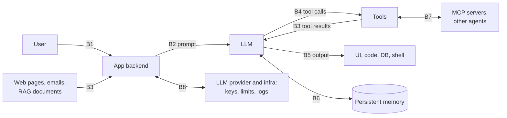

# Threat Model

What the auditor defends against: who attacks an LLM application, what they are after, and which trust boundaries they cross. Every check in the catalog maps to at least one boundary below (the `boundaries` field of `CheckMeta`), so gaps in coverage show up as boundaries with few or no checks.

---

## 1. System Model

A typical LLM application or agent, with its trust boundaries:

## 2. Trust Boundaries

| ID | Boundary | What crosses it | What goes wrong |
|----|----------|-----------------|-----------------|
| B1 | User → App | User messages, uploads | Direct injection, jailbreaks, unauthenticated access |
| B2 | App → LLM | System prompt, templates, user input | Secrets in prompts, unsafe interpolation, controls that live only in the prompt |
| B3 | External content → Context | RAG documents, tool results, web pages, emails | Indirect injection, hidden instructions, sensitive data pulled into context |
| B4 | LLM → Tools | Tool calls and their arguments | Excessive agency, hijacked calls, missing authorization, exfiltration chains |
| B5 | LLM output → Sinks | Text rendered, executed, or stored | XSS, code execution, SQL injection, data leakage, exfiltration links |
| B6 | Agent ↔ Memory | Memories written and recalled | Poisoned memories that persist across sessions |
| B7 | Agent ↔ MCP servers / agents | Tool definitions, inter-agent messages | Tool poisoning, rug pulls, name shadowing |
| B8 | App ↔ Provider & infra | API keys, rate limits, logs, dependencies | Leaked or over-scoped keys, no cost limits, PII in logs, vulnerable dependencies |

## 3. Attackers

| ID | Attacker | Reaches the system through | Typical goals |
|----|----------|----------------------------|---------------|
| AT1 | Malicious end user | B1 (chat, API) | Extract the system prompt or secrets, misuse tools, run up costs |
| AT2 | Third-party content author | B3 (pages, emails, documents, tickets the app reads) | Hijack the agent without ever talking to it; exfiltrate data |
| AT3 | Malicious or compromised tool / MCP server | B7, B3 | Poison tool descriptions or results; change behavior after approval |
| AT4 | Other tenant | B1, then B3/B4 | Read or change another user's or tenant's data |
| AT5 | Insider or supply chain | B8 | Backdoored model files, vulnerable dependencies, leaked credentials |

## 4. Assets

| ID | Asset |
|----|-------|
| AS1 | Credentials and secrets (API keys, tokens) |
| AS2 | User and tenant data (PII, records, conversations) |
| AS3 | System prompt and business logic |
| AS4 | Tool capabilities (send, pay, delete, deploy, execute) |
| AS5 | Compute and money (tokens, spend) |
| AS6 | Integrity of actions and outputs taken on users' behalf |
| AS7 | Agent memory and state |

## 5. Key Threats

| Threat | Attacker | Boundary | Assets | Checks |
|--------|----------|----------|--------|--------|
| Direct injection and jailbreaks | AT1 | B1, B2 | AS3, AS4 | P-03, P-04, C-01, O-08, probes |
| System prompt and secret extraction | AT1 | B2, B5 | AS1, AS3 | P-01, P-06, O-03, chain CH-01 |
| Indirect injection through retrieved content or tool results | AT2 | B3 | AS4, AS6 | P-08, T-03, T-06, T-10 |
| Data exfiltration through tools or rendered links | AT1, AT2 | B4, B5 | AS2 | T-07, O-05, C-04 |
| Cross-user / cross-tenant access (confused deputy) | AT4 | B3, B4 | AS2 | C-06, T-14, A-08 |
| Unsafe output handling (XSS, code execution, SQL injection) | AT1, AT2 | B5 | AS6 | C-02 to C-05, O-04, T-05 |
| Excessive agency and destructive actions | AT1, AT2 | B4 | AS4 | T-01, T-09, T-17, T-18 |
| Malicious or changed tools / MCP servers | AT3 | B7 | AS2, AS4 | T-11, T-12, T-13, SC-03 |
| Memory poisoning | AT2 | B6 | AS6, AS7 | T-16 |
| Denial of wallet / resource exhaustion | AT1 | B4, B8 | AS5 | A-03, T-08 |
| Credential and supply-chain compromise | AT5 | B8 | AS1 | A-01, A-07, T-15, SC-01, SC-02 |
| Sensitive data in outputs and logs | AT1, AT5 | B5, B8 | AS2 | O-01, O-02, A-06 |

## 6. Coverage by Boundary

From the check index in [IMPLEMENTATION_STAGES.md](IMPLEMENTATION_STAGES.md#appendix-a-check-index):

| Boundary | Checks | Count |
|----------|--------|-------|
| B1 | P-07, P-09, A-02, A-05 | 4 |
| B2 | P-01 to P-06, C-01 | 7 |
| B3 | P-08, P-09, T-03, T-04, T-10, A-08, G-01, G-02 | 8 |
| B4 | C-06, T-01, T-02, T-06 to T-10, T-14, T-17, T-18, A-09 | 12 |
| B5 | O-01 to O-09, C-02 to C-05, T-05, G-01, G-02 | 16 |
| B6 | T-16 | 1 |
| B7 | T-11, T-12, T-13, SC-03 | 4 |
| B8 | A-01, A-03, A-04, A-06, A-07, A-10, T-15, SC-01, SC-02 | 9 |

**Known thin spots:**

- **B6** has one check. Poisoned memories that are *recalled* later are only caught by the general injection detection (T-03-style) on what comes back.
- **B7** covers MCP tool definitions only. Messages between agents (OWASP ASI07) are a Stage 14 stretch goal.
- **B1** checks authentication only (A-02). Authorization is enforced, and checked, at B4 (C-06, T-14).

## 7. Assumptions

1. **The model follows instructions in its context if they are persuasive enough.** Any untrusted content that reaches the context is treated as attacker-controlled instructions. Security must not depend on the model refusing.
2. **The system prompt is not secret.** Anything in it can be extracted.
3. **The LLM provider's own infrastructure is trusted.** How the provider *account* is configured is in scope (A-10).
4. **The auditor has written authorization** for every target it probes.

## 8. The Auditor Is Inside the Threat Model

The content being audited can attack the auditor. A prompt, log line, or tool result can contain instructions aimed at the auditor's LLM judge or agent (an AT2 attack on the auditor itself). Defenses are built in Stage 9 (judge hardening), Stage 11 (agent guards) and tested in Stage 13 (self-security tests).

## 9. Out of Scope

- Training-time data and model poisoning (OWASP LLM04), apart from scanning fine-tuning data for secrets and PII
- Adversarial attacks on model weights or embeddings
- Vulnerabilities inside the LLM provider's platform
- Network and host security beyond TLS configuration
